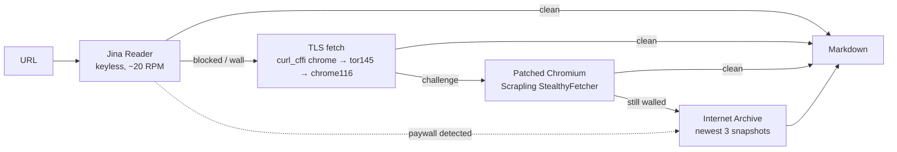

<p align="center"></p>
<h1 align="center">webtrawl</h1>
<p align="center"><b>Your agent's interface to the open web.</b><br>
One page costs <b>43,657 tokens</b> instead of <b>291,846</b> — and a paywall is reported as a paywall, never returned as the article.</p>

<p align="center">
<a href="https://github.com/aiandcivilization/webtrawl/actions/workflows/ci.yml"></a>
<a href="LICENSE"></a>

<a href="https://docs.astral.sh/uv/"></a>
</p>

---

## The problem

Your agent has a search tool and a fetch tool. Both lie in silence:

- the fetch tool returns a **cookie panel** or a **paywall** as if it were the page, and the model reasons from the wall;
- the search tool returns a **URL**, then the agent pulls **291,846 tokens** of navigation, tracking and inline JSON to read 43,657 tokens of article;
- when one provider rate-limits, the whole research run stops.

`webtrawl` is one binary that fixes the three. It searches across several providers with a keyless fallback, then extracts a page through a **four-tier cascade** that *classifies walls instead of returning them*, and prints a token-cheap, agent-shaped result.

```console
$ webtrawl news "central bank rates" -n 3
provider: tavily
vertical: news
mode: keyless                      # no API key configured at all
...
columns[8]: n,title,url,type,date,source,snippet,extract_cmd
rows[3,]{n,title,url,type,date,source,snippet,extract_cmd}:
  1,Russian Central Bank Holds Key Interest Rate Steady,...,web,...,webtrawl extract https://... --max-chars 3000
```

Every row carries the **next command to run**. There is no JSON flag and no JSON on stdout: output is [TOON](https://github.com/toon-format/spec), which the agent reads directly.

## Install

```bash
uv tool install "git+https://github.com/aiandcivilization/webtrawl.git"
```

Try before installing:

```bash
uvx --from "git+https://github.com/aiandcivilization/webtrawl.git" webtrawl --help
```

`pipx install "git+https://github.com/aiandcivilization/webtrawl.git"` and `uv sync` from a clone work too. Python 3.12+.

## Zero keys, thirty seconds

Nothing below needs an account. Tavily runs in keyless mode, Jina Reader is keyless, Google News RSS is keyless, and the Internet Archive is keyless.

```bash
webtrawl news "turbinate surgery recovery" -n 5     # keyless news
webtrawl web "scrapling cloudflare bypass" -n 5     # keyless web (tavily access mode)
webtrawl extract "https://en.wikipedia.org/wiki/Car" --max-chars 2000
webtrawl providers                                  # what is ready, and from where
```

Add keys later to raise rate limits and unlock Brave, Parallel and TinyFish — see [API keys](#api-keys).

## What it does differently

**1. Two stages, and the CLI names the second one.** `web` / `news` are discovery. `extract` is the document. Each result row ships its own `extract_cmd`, plus a tail block that tells the agent *"search is step 1, you must now extract"*. That one convention removes the most common agent failure: quoting a snippet as if it were the source.

**2. A cascade, not a fetcher.** `extract` escalates only when the cheaper tier fails:



Each attempt is timed and reported (`tiers[]`), so the agent knows which transport served the text and how long it took. A paywall found at tier 1 skips the browser tiers: JavaScript cannot lift a server-side paywall, so the budget goes to the archive instead.

**3. A wall is classified, never returned.** Four wall types are detected by signature phrase density — `cookie wall`, `paywall`, `login wall`, `maintenance page`. Cookie containers are dismissed by vendor selector (`#tarteaucitronRoot`, `#didomi-host`, `#onetrust-consent-sdk`, …) and never by clicking the first button that says *OK* — an ancestor of that mistake navigated a genealogy page to the wrong record.

**4. Facts outside the prose.** Trafilatura keeps the densest `<article>` node and drops everything else, including the JSON-LD that carries price, availability, SKU and rating. `extract --structured` reads JSON-LD, microdata and OpenGraph, and returns normalised offers. It is generic: no vertical is hardcoded.

**5. Pagination that does not re-fetch.** Long pages are cached on disk and sliced with `--offset` / `--max-chars`. The second read is a file seek, not a network call, and the response carries `next_cmd` so the agent cannot forget where it was.

**6. Pictures and manuscripts.** `image` downloads a picture with the referer the CDN expects, stitches Zoomify pyramids at native resolution (`--full`) or only the rectangle you asked for (`--region`). `ocr` reads it: a local Tesseract floor for print, a hedged vision chain for handwriting, and `[illisible]` instead of a guessed word. The transcription is never silently degraded.

**7. Semantic exit codes.** `0` ok · `1` transient (retry) · `2` auth missing · `3` bad input · `4` rate limited. An agent can branch on the code instead of parsing stderr. `webtrawl agent-info` prints the whole contract as TOON, so a harness can discover the tool at runtime.

## Commands

| Command | What it does |
|---|---|
| `webtrawl web QUERY` | Discovery across Brave, Tavily, Parallel, TinyFish (`-m`, `-n`, `-f day\|week\|month\|year`, `--country`, `--lang`, `--offset`, `--compact`). |
| `webtrawl news QUERY` | News vertical with Google News RSS as the keyless safety net. |
| `webtrawl extract URL` | Page **or** document (`.pdf/.docx/.xlsx/.csv`) to markdown, through the cascade. `--offset`, `--max-chars`, `--brute`, `--wayback`, `--structured`. |
| `webtrawl image URL...` | Download pictures, including the ones behind a bot wall; `--full`, `--region X,Y,W,H`. |
| `webtrawl ocr TARGET...` | Read a picture: `-p auto\|gemini\|vlm\|mistral\|tesseract`, `--lang`, `--region`, `--deep`. |
| `webtrawl providers` | Every search, extraction and OCR provider, with readiness and key source. |
| `webtrawl agent-info` | Self-describing manifest: commands, arguments, exit codes. |
| `webtrawl config set\|show\|check` | Persist keys to `~/.config/webtrawl/config.toml` (0600). |

## API keys

Everything is optional. `webtrawl providers` shows which key is resolvable and where it came from — never the key itself.

| Key | Environment variable | Unlocks | Free tier | Get it |
|---|---|---|---|---|
| Brave Search | `BRAVE_API_KEY` | Independent 30B-page index; web + news verticals. Best snippet quality. | 2,000 queries/month (Search + Answers). New keys require a card. 1 req/s. | [api-dashboard.search.brave.com/app/keys](https://api-dashboard.search.brave.com/app/keys) |
| Tavily | `TAVILY_API_KEY` | Agent-optimised discovery. **Works keyless** without this key. | 1,000 credits/month, no card. Keyless mode is a shared, rate-capped pool. | [app.tavily.com/home](https://app.tavily.com/home) |
| Parallel | `PARALLEL_API_KEY` | Neural web search, deepest domain coverage. | Free credit grant (~5k requests/month); $1 per 1k calls after. | [platform.parallel.ai](https://platform.parallel.ai) |
| TinyFish | `TINYFISH_API_KEY` | Fast live-rendered search. | Free at any wallet balance, including $0. Key required. 30 req/min. | [agent.tinyfish.ai/api-keys](https://agent.tinyfish.ai/api-keys) |
| Google AI Studio (Gemini) | `GEMINI_API_KEY` | OCR of handwriting and degraded print. | Free tier, requests-per-day bound. EU/UK/CH free tier is restricted for products with users. | [aistudio.google.com/apikey](https://aistudio.google.com/apikey) |
| OpenRouter (VLM) | `VLM_API_KEY` | OCR through any OpenAI-compatible vision model, free models included. | Free models cost $0; latency is the price. | [openrouter.ai/keys](https://openrouter.ai/keys) |
| Mistral OCR | `MISTRAL_API_KEY` | Document OCR with bounding boxes and per-word confidence. | No documented free API tier: $4 per 1,000 pages. | [console.mistral.ai/api-keys](https://console.mistral.ai/api-keys) |
| — (no key) | — | Jina Reader, Google News RSS, Internet Archive, Tesseract, Tavily keyless. | Always free, rate-capped. | — |

### How to get each key

**Brave Search** — 1. Go to [api-dashboard.search.brave.com](https://api-dashboard.search.brave.com/app/keys) and sign up. 2. Pick the **Free** plan (2,000 queries/month). 3. A card is required for new keys; the plan stays at $0 inside the quota. 4. Create a key and copy it:

```bash
webtrawl config set brave YOUR_KEY     # or: export BRAVE_API_KEY=...
```

**Tavily** — 1. Sign up at [app.tavily.com](https://app.tavily.com/home). 2. The dashboard shows `tvly-…` under **API Keys**; a credit card is not required. 3. `webtrawl config set tavily tvly-…`. You can skip this entirely: `-m tavily` already works keyless.

**Parallel** — 1. Create an account at [platform.parallel.ai](https://platform.parallel.ai). 2. Copy the key from **API keys** in the dashboard. 3. `webtrawl config set parallel YOUR_KEY`.

**TinyFish** — 1. Sign in at [agent.tinyfish.ai](https://agent.tinyfish.ai/api-keys). 2. Generate a key on the **API keys** page; no payment method is needed. 3. `webtrawl config set tinyfish YOUR_KEY`.

**Google AI Studio (optional, OCR)** — 1. Open [aistudio.google.com/apikey](https://aistudio.google.com/apikey) with a Google account. 2. **Create API key**, choose a project. 3. `webtrawl config set gemini YOUR_KEY`, or `export GEMINI_API_KEY=...`. If you are in the EU/UK/CH and ship a product with users, use the paid tier or the VLM path below.

**OpenRouter VLM (optional, free OCR)** — 1. Create a key at [openrouter.ai/keys](https://openrouter.ai/keys). 2. `webtrawl config set vlm sk-or-…`. 3. The default model is free; to use another OpenAI-compatible host (Zhipu `glm-4v-flash`, DashScope, SiliconFlow):

```bash
export VLM_BASE_URL=https://open.bigmodel.cn/api/paas/v4
export VLM_MODEL=glm-4v-flash
```

**Mistral OCR (optional)** — 1. Create a key at [console.mistral.ai/api-keys](https://console.mistral.ai/api-keys). 2. `webtrawl config set mistral YOUR_KEY`. 3. Use it explicitly with `webtrawl ocr page.jpg -p mistral`.

Resolution order for every key: environment variable first, then `~/.config/webtrawl/config.toml` (`[keys]`, mode 0600). Never commit a key; `.env` and `.env.*` are gitignored here, and this repository ships no credential.

## Configuration

| Variable | Default | Purpose |
|---|---|---|
| `WEBTRAWL_CONFIG` | `~/.config/webtrawl/config.toml` | Key file read and written by `webtrawl config`. |
| `WEBTRAWL_CACHE_DIR` | `~/.cache/webtrawl/extract_cache` | Extracted markdown cache (1 h TTL, 5 min for failures). |
| `WEBTRAWL_IMAGE_CACHE_DIR` | `~/.cache/webtrawl/images` | Downloaded pictures and stitched tiles. |
| `WEBTRAWL_BROWSER_PROFILE` | unset | Playwright profile directory reused by the Chromium tier. |
| `WEBTRAWL_OCR_CONFIG` | `~/.config/webtrawl/ocr.toml` | Overrides the OCR model registry. |
| `WEBTRAWL_OCR_CACHE` | `~/.cache/webtrawl/ocr` | OCR transcription cache and provider health file. |
| `VLM_BASE_URL` / `VLM_MODEL` | OpenRouter / free model | Point the vision provider at any OpenAI-compatible host. |

Cache entries are disposable: bumping `extract_cache.CACHE_SCHEMA` invalidates every record written under a looser gate.

## Measured

Same URLs, same tokenizer (`o200k_base`), raw HTML from `curl` versus `webtrawl extract --max-chars 0`:

| Page | Raw HTML tokens | `webtrawl` tokens | Cut | Time (`--no-cache`) |
|---|---|---|---|---|
| `en.wikipedia.org/wiki/Car` | 291,846 | 43,657 | **−85.0 %** | 2.0 s |
| `docs.python.org/3/library/asyncio.html` | 6,943 | 965 | **−86.1 %** | 0.5 s |

TOON against compact JSON on the same ten news rows: 2,410 tokens instead of 2,590 (−6.9 %). The format matters less than the shape: stable columns, a `type` per row, and an `extract_cmd` the agent can run without reconstructing a URL. Reproduction commands and the raw transcript: [`docs/benchmark.md`](docs/benchmark.md).

## Development

```bash
uv sync
uv run pytest -q          # 9 offline contract tests, no network
uv run ruff check .
uv build
```

Architecture, cascade internals and the failure that produced each rule: [`docs/architecture.md`](docs/architecture.md). Exit codes: [`docs/exit-codes.md`](docs/exit-codes.md). Why the tool is shaped this way, with the public evidence: [`docs/positioning.md`](docs/positioning.md).

## License

MIT © Yanis Labeyrie. The vendored `src/_vendor/cli_common` subset is MIT as well; provenance and the edits applied to it are recorded in [`VENDOR.md`](src/_vendor/cli_common/VENDOR.md).

<p align="center"><sub>No account required · keys optional · output stays on stdout · MIT</sub></p>
