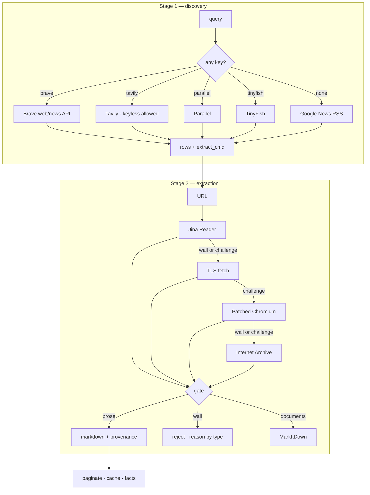

# Architecture

`webtrawl` is a two-stage tool: **discovery** turns a query into rows with URLs,
**extraction** turns a URL into text, facts or a picture. Everything else exists
to make one of those two steps survive the real web.



## Code map

| Module | Role | Why it exists |
|---|---|---|
| `cli.py` | Typer app, command wiring, TOON rendering, `agent-info` manifest. | One place that decides exit codes and output shape. |
| `providers.py` | Brave, Tavily, Parallel, TinyFish, Google News; the extraction cascade; wall detection; sanitising. The largest module by design: every tier obeys the same signature. | Transport decisions belong together; splitting them hides the fallback order. |
| `structured.py` | JSON-LD, microdata, OpenGraph, money parsing, offers, ratings. | Facts are published outside the prose node that Trafilatura keeps. |
| `extract_cache.py` | On-disk cache, `CACHE_SCHEMA` invalidation, offset pagination. | An agent re-reads the same page; a second read must not cost a request. |
| `documents.py` | PDF/Office/CSV to markdown via MarkItDown. | A document URL is still a URL, and `extract` must handle it. |
| `images.py` | Picture download, referer repair, Zoomify tile stitching, regions. | The only evidence on some pages is a scan. |
| `ocr.py` | Adapter over the vendored OCR engine. | Names (`-p gemini`) map onto the registry, never re-implement a provider. |
| `render.py` | `print_payload`, `err`, `fail`, structured rendering. | Stdout stays byte-clean; diagnostics go to stderr only. |
| `hydration.py`, `jsvalue.py`, `search_cache.py` | Inline-JS page reconstruction, JS-literal parsing, per-query cache. | Client-rendered pages and concatenated JSON need their own parsers. |
| `_vendor/cli_common/` | TOON encoder, OCR engine, model registry. | Vendored so the wheel installs with no private dependency. |

## The extraction gate

Every tier returns `(text, report)`. The gate then answers three questions in
order, and each answer has a measured failure behind it:

| Question | Check | Failure it prevents |
|---|---|---|
| Is this a bot wall? | `is_bot_blocked`: challenge phrases, `challenge-platform`, Vercel checkpoint. | Returning a 242-character "Security Checkpoint" as content. |
| Is this a consent/paywall/login/maintenance page? | `detect_wall`: two signature phrases, or one phrase heading a short document. | Answering from a cookie panel (2,765 chars) as if it were the record. |
| Is it complete? | `extraction_is_complete`: text share of raw HTML bytes, disabled for the browser and archive tiers. | Accepting a client-rendered shell of 84 KB HTML and 643 chars of prose. |

Priority is `paywall → login wall → cookie wall`: a page can carry both, and the
paywall is the useful classification. A paywall passes the gate but is recorded
as `partial`, so the archive can replace it.

## Wall detection is intentionally conservative

Two distinct phrases classify a wall. One phrase only counts when it heads a
document under 2,500 characters and the whole text is under 6,000 — otherwise a
long article that merely mentions "abonnez-vous" would be rejected. Signs of
real content (paragraph length, link density) are checked before that.

## Consent dismissal

`dismiss_cookie_banner` only touches known vendor containers:

```text
#tarteaucitronRoot  #didomi-host  #onetrust-consent-sdk  #axeptio_overlay
.cky-consent-container  #cookiebot  #CybotCookiebotDialog
```

It prefers *reject*, then *accept*, then removes the container after 50 ms. It
never clicks a generic button: the first implementation matched `ok` inside
"Family Book" and navigated a genealogy page to a different record. That
regression is why the selector list is closed.

## Transport details that cost a debugging round

- **Timeout units.** `StealthyFetcher` wants milliseconds; `Fetcher.get` wants
  seconds. Passing milliseconds to the second one turned a 20 s budget into
  20,000 s × 3 retries.
- **TLS fingerprints.** `curl_cffi`'s default `chrome` is 403 on some Cloudflare
  JA3/JA4 rules. The cascade rotates `chrome → tor145 → chrome116` (0.9–3.4 s,
  no browser) before launching Chromium.
- **Concurrency.** One semaphore bounds the whole picture command: 18 parallel
  connections made the CDN throttle and took 65 s; 8 shared connections do the
  same work in 3 s. A cancelled async task stops at its await; a cancelled
  thread does not, and used to keep the process alive for its full socket
  timeout.
- **Zoomify groups.** The CDN ignores `TileGroupN`; a standard Zoomify install
  does not. If a tile 404s at a high level, compute the group before suspecting
  the coordinates.

## Cache

`~/.cache/webtrawl/extract_cache/<sha256>.json` holds the markdown, the source
HTML hash, the tier report and the schema version. TTL is one hour for content
and five minutes for a failure, so a page that recovers is retried quickly. A
schema bump invalidates every entry: entries are disposable and a record written
under a looser gate may hold a wall.

`--no-cache` skips reads and writes. `--offset` reads the cache and slices it,
which is what makes long-document scrolling free.

## What is deliberately absent

- No MCP server. A CLI is callable by every harness; an MCP server is one more
  process to keep alive. `agent-info` gives a harness everything it needs.
- No `--json` flag. JSON is transport for machine *input*; on stdout it is
  noise that the agent pays for twice.
- No residential proxy. Egress reputation is the operator's decision, not a
  hidden runtime dependency.
